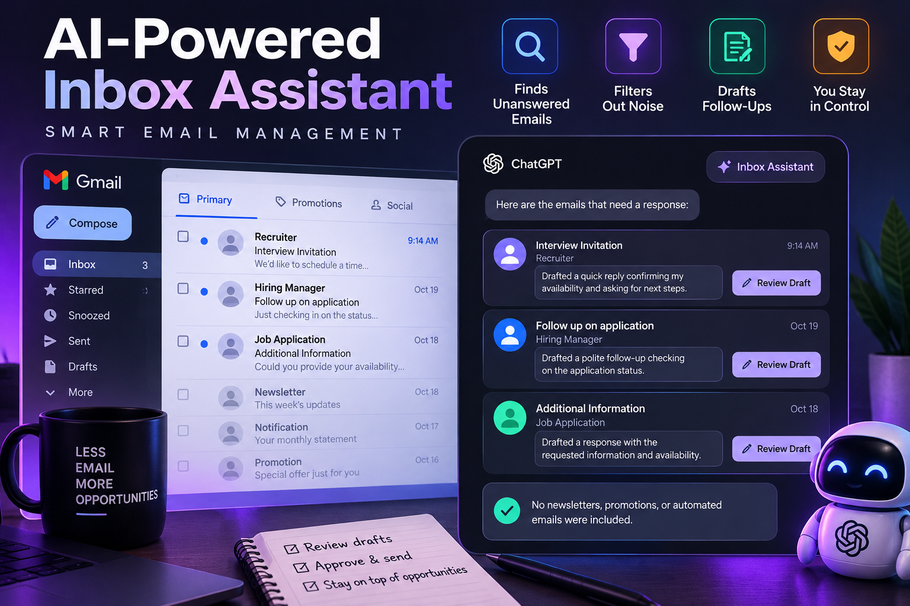

# ✉ Inbox Pilot — AI-Powered Inbox Assistant

A runnable, local-first Gmail follow-up assistant with an elegant web UI. Find messages that *might* need a reply, read the actual conversation alongside an editable suggestion, and **send each reply only after explicit approval**.



## Features

- Google OAuth Gmail connection, with read/modify and send scopes
- Configurable 7–90-day search and minimum wait threshold
- Conversation-aware ranking: skips threads where you replied last, typical automated mail, and messages with no obvious request
- Original email and editable reply displayed side by side
- Optional OpenAI drafting (falls back to a safe generic acknowledgment without an API key)
- Deliberate per-thread send flow: save edits, type `SEND THIS REPLY`, and accept the browser confirmation
- **Demo mode** with fictitious email examples and sending disabled
- Responsive, mobile-friendly dark dashboard

## Quick start

Python 3.10+ recommended.

```bash
git clone https://github.com/YOUR_USERNAME/inbox-pilot.git
cd inbox-pilot
python -m venv .venv
source .venv/bin/activate
pip install -r requirements.txt
cp .env.example .env
python server.py
```

Open http://127.0.0.1:5000 and select **Explore sample inbox** to test instantly.

### Gmail connection

1. In [Google Cloud Console](https://console.cloud.google.com/), create/select a project.
2. Configure the OAuth consent screen (External/testing as applicable) and add your Gmail user as a test user if the app remains in testing.
3. Create a **Web application** OAuth 2.0 client.
4. Add `http://localhost:5000/oauth/callback` to **Authorized redirect URIs**.
5. Copy the client ID and secret into `.env` and set `FLASK_SECRET_KEY` to a random string (e.g. `python -c 'import secrets; print(secrets.token_hex(32))'`).
6. Restart the server and select **Connect Gmail**.

Some Gmail scopes are restricted/sensitive and a public deployment may require Google verification and security assessment. For a local personal prototype, use the appropriate test configuration. Do not commit `.env` or OAuth tokens.

### Optional AI-generated replies

Add an `OPENAI_API_KEY` to `.env` and choose the model using `OPENAI_MODEL`. This sends excerpts of relevant conversation threads to the selected AI service for drafting. **Do not enable it for confidential messages unless you have permission to share their content.** Without the key, the app uses a generic draft that should be carefully edited.

## How it works

1. **Scan** the mailbox for recent activity.
2. Fetch entire conversation threads to establish who sent the last message.
3. Exclude obvious automated/promotional messages, recent messages below your chosen wait threshold, and messages lacking a clear request.
4. Create an initial draft and display it beside the actual email history.
5. Edit/save, and optionally explicitly send a *single* thread. The app never sends in the background.

The filtering is heuristic, not guaranteed to find every email awaiting action. Search results are capped at 100 recent messages in this prototype. A message can need a reply without having a question mark or request keywords; review your inbox as well.

## Safeguards and limitations

- Demo mode **cannot send** email.
- Scanning/drafting **never sends** email.
- Gmail tokens and draft state are kept in local server memory, not committed to disk. Restarting the server clears them; token expiry may require reconnecting.
- Only run locally on `127.0.0.1` without adding production-grade user accounts, persistent encrypted session storage, CSRF protection, token refresh, rate limiting, and HTTPS.
- This is a **manual app**, not an automatically scheduled monitoring agent. Recurring scheduling is a future enhancement.
- UI examples are fictitious; the app does not claim to have obtained interview invitations in your inbox.

## Run tests

```bash
pytest -q
```

## Suggested roadmap

- Microsoft Outlook/Microsoft Graph support
- Scheduled scans with notifications (but never automated sending)
- Encrypted persistent state and multi-user deployment
- User-configurable VIP senders, urgency tags, and semantic classification
- Full pagination, stronger tracking of reply status, and per-message audit history

## Tech stack

Python · Flask · Gmail API · Google OAuth 2.0 · OpenAI API (optional) · HTML/CSS

## License

MIT — see [LICENSE](LICENSE).
